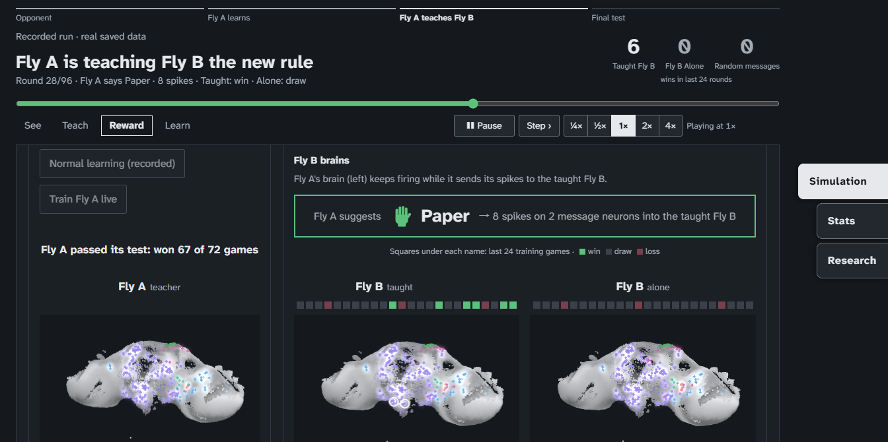

# Synapse: two brains, one learned message

**When the rules of a game changed, a trained simulated fruit-fly brain helped an untrained one recover, by sending spikes on two neurons, never its weights.**



## For judges: the 30-second version

| Step | What we found |
|---|---|
| **The problem** | When conditions change, the system that adapted first can't help a differently built one catch up: the models don't match, and data or weights often can't be shared. A bank that spots a new scam first has no safe way to warn a bank that hasn't. |
| **The question** | Is a few bytes of advice enough, with no data and no weights sent? |
| **The test** | Two brains from a real fruit-fly wiring diagram (6,900 simulated neurons, 990,102 synapses), with different learners, linked only by two neurons. The opponent changes its Rock-Paper-Scissors rule, Fly A sends its preferred move as spikes, and Fly B is then tested alone with Fly A unplugged. |
| **The answer** | **Yes, it speeds up recovery.** 48 rounds after the change, taught Fly B won **68 of 72** games, against 33 with shuffled messages and 10 alone. Lead over the best control in each run: **+24.9** (95% CI +17.8 to +32.1, 15 runs, protocol fixed in advance). |
| **Does it hold up?** | It passed on a second task (+19.0) and on a simulator we wrote ourselves (+35.0, in the 10 of 15 runs where the teacher learned). |
| **Where it stops** | Simulation only, on two small tasks. A plain digital message works as well as spikes, and the gain is speed, not a higher final score. Two studies on trusting a teacher missed their bars, and several earlier experiments failed: see the Research tab and the [lab notebook](docs/lab-notebook.md). |

**Run it:** `python tools/serve.py`, then open <http://localhost:8766> and press **▶ Watch the demo** (1½ minutes, recorded real run). Judge script and Q&A: [docs/pitch-script.md](docs/pitch-script.md).

---

Synapse adapts [Fly Hero](https://github.com/bsgelman/fly-hero) by Benjamin Gelman, a simulated fruit-fly connectome that learns a rhythm game, into a two-fly Rock-Paper-Scissors (RPS) teaching experiment.

## Run locally

You need Python 3 and a current browser with WebGL. Three.js is vendored in `vendor/three/`, so there is nothing to install and the demo works offline.

```bash
python tools/serve.py
```

Open <http://localhost:8766>. Serve the whole repository; opening `index.html` as a file will not load the data.

| Page | What it shows |
|---|---|
| `/` | The problem (Usage tab), the recorded demo and live Challenge (Simulation tab), the 15-run result (Statistics tab), and claims and limits (Research tab) |
| `/archive.html` | Earlier experiments that failed their gates |
| `/legacy.html` | The first RPS experiment, with its older message channel |
| `/rhythm.html` | The original Fly Hero rhythm game |

Checks need Node.js, and NumPy for the Python ones. `npm test` takes under two seconds and needs nothing installed (the two demo checks need `npm ci` once, because Node loads three.js from `node_modules`; the browser uses the vendored copy): it recomputes every headline number from the saved per-seed results and fails if the summary files, this README, or the page disagree. The same checks run on every push (`.github/workflows/checks.yml`). [tools/README.md](tools/README.md) lists which script belongs to which study.

```bash
npm test                                  # headline numbers match the saved results; local links resolve
npm ci                                    # once, before the two demo checks
node tools/check_rps_challenge_demo.mjs   # main demo
node tools/check_rps_demo.mjs             # legacy page
python -m flyhero.test                    # original rhythm model, Python/JavaScript parity
python -m unittest flyhero.test_rps -v    # RPS environment
```

## How the result is produced

- **The brain.** `data/subgraph.json` holds 6,900 neurons and 990,102 connections from the Janelia/Google male CNS connectome, run as a leaky integrate-and-fire simulation (`js/sim.js`, a port of `flyhero/sim.py`). Both flies use the same wiring, and it never changes.
- **The learners are engineered, not biological.** Each fly reads its own brain's activity through a small reward-trained readout (`js/rps.js`, `js/rps_challenge_students.js`). This is a hybrid system, not the original dopamine-only rule. Fly A's readout and Fly B's have different structures, so weights could not be copied between them.
- **The message.** After the rule change, Fly A's preferred move is driven as spikes on a pair of descending neurons (DNge175). Fly B decodes the spike counts and adds an imitation update to its own reward learning.
- **The test.** At 0, 24, 48, and 96 rounds after the change, Fly B is frozen, Fly A is disconnected, and Fly B plays 72 games alone.
- **The controls.** No teacher, random messages, shuffled messages, and an untrained teacher. Random and shuffled messages also beat learning alone (32 and 33 against 10), so the teacher's own contribution is the +24.9 over the best control, not the gap to "alone". The protocol, seeds, and analysis were fixed before the 15 runs: [protocol](docs/rule-switch-cohort-protocol.md), [results](data/rule_switch_cohort_summary.json), `node tools/check_rule_switch_cohort.mjs SEED`.

## What this does not show

- **Spikes are not better than a cable.** Sending the same advice as a plain digital message worked equally well. The result is that learned advice survives a neural channel, not that neurons are needed.
- **It is a known idea.** Sending a preferred action to a learner is action advising. The contribution is the controlled test in a connectome simulation, not a new learning method.
- **Fly B trusts its teacher.** It follows advice without checking it. In a locked 15-run control, a Fly A trained on the *old* rule gave no help: at 48 rounds its students won 1 of 72 on average, against 68 with the new-rule teacher (difference +67.1, 95% CI +65.6 to +68.4) and 14 alone. By 96 rounds the out-of-date teacher had held its students 30 wins below learning alone (1 against 31). So the gain comes from what the teacher knows about the current rule, and a wrong teacher does harm. [Protocol](docs/stale-teacher-cohort-protocol.md), [results](data/stale_teacher_cohort_summary.json).
- **Checking the teacher helps, but not fully.** We then let Fly B learn from its own wins how much to trust its teacher. In a locked study (14 completed runs), this removed most of the harm from the old-rule teacher: 36 of 72 wins at 96 rounds, against 1 without the check (difference +34.2, 95% CI +25.6 to +42.0). It kept the new-rule teacher's speed-up (0.8 wins lower at 48 rounds, CI 0.1 to 1.6). But these students still ended 7.5 wins below learning alone (43; CI 2.2 to 12.9 below), so the study's pass rule, which required no remaining harm, **failed**. [Protocol](docs/trust-gate-cohort-protocol.md), [results](data/trust_gate_cohort_summary.json).
- **Two teachers who disagree: a narrow fail.** Fly B heard a new-rule and an old-rule teacher on every round without being told which was which, and kept a trust value for each. In a locked study (14 completed runs) it ended at 70 of 72 wins at 96 rounds, the same as hearing only the new-rule teacher on every run, and 34 above learning alone. But a Fly B that followed both equally reached 62 by then, so the lead from choosing was +8.4 (95% CI +3.8 to +13.6), just under the +4 lower bound the protocol required, and the study **failed** its pass rule. The lead was larger earlier (68 against 50 at 48 rounds), but that was not the locked test; the 96-round endpoint was chosen after a 3-run pilot that had failed at 48. [Protocol](docs/two-teacher-cohort-protocol.md), [results](data/two_teacher_cohort_summary.json).
- **Speed, not a higher final score.** In the longer archived study, flies learning alone caught up by round 288.
- **A second task passed on the third test.** We replaced RPS with a fault-response task: three alarms in random order, three responses, and a change in which response fixes each fault. In a locked 15-run study the taught fly led the best control by **+19.0** wins at 48 rounds (95% CI +11.8 to +26.2): 70 of 72 against 44 shuffled, 36 random, 25 untrained teacher, and 8 alone. Two 3-run pilots came first and both failed their rules: with a small change Fly B recovered alone within 24 rounds and the teacher added nothing; with this large change the lead was 25, 0, and 25 and the pilot rule needed all three. We had said we would stop, then reopened it as a full test with the averaged rule the RPS study used. Three earlier second tasks stopped before teaching was tried. [Protocol](docs/fault-response-cohort-protocol.md), [results](data/fault_response_cohort_summary.json), [pilot 1](docs/fault-response-pilot-protocol.md), [pilot 2](docs/fault-response-full-change-protocol.md).
- **Two small tasks, in simulation.** Fixed rules, three cues and three choices, and one kind of change in each. A noisy-opponent test and an all-student spike-loss check failed. The real-world uses below are untested motivation.
- **A partial circuit.** The connectome is a right-side mushroom-body circuit plus downstream nerve cord, and the RPS inputs, action groups, and fly-to-fly channel are engineering choices, not fly biology.

## Two simulators

- `js/sim.js` is the neural simulator from Fly Hero. The demo and every study except the one below use it.
- `js/engine.js` was written for this project: the same Shiu et al. neuron model and connectome file, solved exactly over each 1 ms step where `js/sim.js` uses an approximate (Euler) step, and with random input applied in a different order. Its spike trains differ from `js/sim.js`'s. `node tools/test_engine.mjs` checks it against closed-form answers.
- **Replication on `js/engine.js` (locked, 15 seeds): passed, with a caveat.** With no learner setting re-tuned, 10 of 15 runs completed and the taught fly led the best control by +35.0 wins at 48 rounds (95% CI +28.2 to +41.4; more than 4 on every completed run). On the other 5 runs the teacher scored 47 to 54 against its 58-of-72 bar and the run stopped; on `js/sim.js` no teacher failed in 15. Activity in the output neurons is lower on the new engine, and the learners were tuned on the old one. The protocol required at least 10 completed runs and got exactly 10. [Protocol](docs/engine-replication-cohort-protocol.md), [results](data/engine_replication_cohort_summary.json).
- **Follow-up on the teacher (locked, 15 new seeds, teacher only): supported.** With the learner's two input-scaling constants re-measured on `js/engine.js` by a fixed, label-free procedure, the teacher reached its bar on 15 of 15 seeds, against 12 of 15 with the `js/sim.js` constants on the same seeds (mean score 63.7 against 60.4 of 72). The teaching studies have not been re-run with the new constants. [Protocol](docs/engine-teacher-scaling-protocol.md), [results](data/engine_teacher_scaling_summary.json).
- It is a check that the result does not hang on one codebase's numerical choices, not an independent replication: the engine was written after reading `js/sim.js`, the learners build on Fly Hero's learner classes, and the 6,900-neuron subset is Fly Hero's selection.

## Where it could be used (untested)

The page's Research tab sets out seven possible uses, each with published research on why a model or data could not be sent instead: mixed robot fleets, hospitals, banks and fraud, underwater vehicles, brain-like (neuromorphic) chips, brain-computer interfaces, and old equipment that cannot be updated. The supporting work:

- Advice helps a differently built learner on a limited advice budget: [Torrey & Taylor 2013](https://ifaamas.csc.liv.ac.uk/Proceedings/aamas2013/docs/p1053.pdf).
- Sharing weights needs matching models ([McMahan et al. 2017](https://arxiv.org/abs/1602.05629)) and shared updates can leak training data ([Zhu et al. 2019](https://arxiv.org/abs/1906.08935)); sharing outputs works across different models ([Li & Wang 2019](https://arxiv.org/abs/1910.03581)).
- Deployed rules do change: clinical models ([Finlayson et al. 2021](https://doi.org/10.1056/NEJMc2104626)), card fraud ([Dal Pozzolo et al. 2018](https://doi.org/10.1109/TNNLS.2017.2736643)).
- Real flies learn from other flies ([Danchin et al. 2018](https://doi.org/10.1126/science.aat1590); [Battesti et al. 2012](https://doi.org/10.1016/j.cub.2011.12.050)).

Brain-like chips are the one case where the spike channel itself would matter, because that hardware computes and communicates in spikes ([Davies et al. 2018](https://doi.org/10.1109/MM.2018.112130359)). None of these uses has been tested here.

## History

The route here included many negative results, all kept:

- [First RPS experiment](docs/earlier-rps-experiment.md): the original dopamine-only learner with a three-neuron channel. **No evidence that the teacher helped.**
- [Lab notebook](docs/lab-notebook.md): every experiment in order, with reproduction commands.
- [Research story](docs/research-story.md) and [demo guide](docs/demo-guide.md): the short narrative and the demo walkthrough.
- `archive.html`: the proposal/veto experiments that failed their teacher-specific gate.

The original rhythm-game source remains in `flyhero/game.py`, `flyhero/agents.py`, and `js/game.js`.

## Credits and license

Original Fly Hero code: Benjamin Gelman, [MIT License](LICENSE). The code retains that license and attribution. The network and brain positions derive from Janelia/Google male CNS data (CC-BY), credited in the original project. Neuron model: Shiu et al., [Nature 2024](https://doi.org/10.1038/s41586-024-07763-9). Dopamine rule inspired by Bennett, Philippides and Nowotny, [Nature Communications 2021](https://doi.org/10.1038/s41467-021-22592-4). The Atkinson Hyperlegible Next font uses the SIL Open Font License in `fonts/OFL.txt`.
