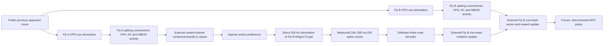

# Locked connectome contribution ablation

This is a new exploratory causal pilot. It does not alter the Strategy A or B teaching results or their gates. The protocol was fixed before this pilot's neural simulation or held-out evaluation.

## Causal pathway and dependency inventory

The real-wiring simulator generates Fly A and Fly B sensory MBON rates. Fly A's action-value controller and Fly B's reward and imitation updates are software readouts outside the connectome; their KC→MBON synaptic weights are frozen. The teacher's preference is encoded by direct drive of DN 3141/3165 and decoded from their *actual simulated spike counts*. The downstream DN wiring is not read by the imitation update. Thus most connectome connectivity is not demonstrably required for message transfer; this pilot tests the spike interface, not a claim that any particular synapse is essential. No connectivity lesion is justified because deleting downstream DN edges would not isolate the count-based message and could only produce an uninterpretable change in spiking.

## Fixed pilot

- Strategy B: deterministic `previous_opponent`, offset 2. Teacher policies are the archived, reward-trained 11013 and 11014 controllers, paired respectively with fresh student seeds **11017** and **11018**. No teacher or student model is selected after observing this pilot.
- Training opponent seeds: 82000–82011 for 11017, 82012–82023 for 11018. Held-out evaluation seeds: 92000, 92001, 92003 for 11017; 92004, 92006, 92009 for 11018. These are fixed independent streams, not selection variables.
- All student arms start with identical zero cue-head parameters and real-wiring neural weights for a given seed. The same 12×24 training rounds, opponent sequences, keyed neural and action random streams, feature standardization, alpha .03 reward update, epsilon .20 exploration, and alpha .03 decoded-preference imitation apply. KC→MBON multipliers stay 1.
- Four arms: **neural** = archived trained teacher preference encoded as R `(1,0)`, P `(0,1)`, S `(1,1)` via 300 Hz DN stimulation during 240–280 ms, then decoded from measured counts; **digital** = exactly the same frozen teacher preference delivered at 280 ms directly to the same imitation update, with no DN stimulation, while the full 680 ms student neural schedule continues; **silent** = no preference or DN drive; **scrambled** = one fixed global seeded permutation of the trained preference tape, transmitted through the same DN route. The permutation preserves action counts and message exposure but breaks trial alignment. It is generated without using opponent outcomes, cue labels, or evaluation data.
- Source teacher remains frozen and continuous across rounds. Student neural state resets each round, with cue VPN stimulation at 150 Hz during 0–240 ms, count reset at 50 ms, action at 240 ms, reward at 280 ms, reward and imitation updates at 620 ms, and round end at 680 ms. No student receives the teacher's hidden strategy as a feature.
- Frozen checkpoints at rounds **0, 6, 12, 24, 48, 96, 288**: fresh simulator/controller copies; three 24-round held-out episodes; no teacher, DN stimulation, exploration, imitation, or reward learning. Save every trial and verify frozen weights stay fixed.

## Prerequisites, comparisons, and stop rules

Before student training, verify each archived teacher met its own prior Strategy B frozen gate (≥58/72 wins, ≥70% per observed cue, ≥12 selections of each action, frozen KC→MBON weights), and that its newly generated preference tape is ≥70% winning per observed cue, contains all three actions, and is frozen. Verify forced DN codes on each fresh student across every cue, 12 matched repeats per condition, meet the existing 12/12 DN decoding and VPN cue-routing/premessage-feature invariance checks. The scramble must change ≥138 of the 276 observed messages, include all actions, and achieve ≤60% winning preference for each cue. If any prerequisite fails, write the failed result and stop without replacement or tuning. No student training occurs before prerequisites pass.

Primary measure: neural minus digital mean frozen wins over rounds 6, 12, 24, and 48, per student, with all seven curves reported. The predefined operational similarity band is ±2/72 for that early mean and ±2/72 at final round 288; exact agreement of training actions, rewards, updates, and checkpoint actions is reported separately. Transmission fidelity must be ≥99% decoded preference agreement on observed neural and scrambled trials, with no zero-bit tie or off-code DN pair. Report neural-minus-silent and neural-minus-scrambled early and final differences. A teacher-information effect in *this pilot* requires neural to exceed both silent and scrambled by ≥4/72 in early mean for **both** students; failure remains a negative or inconclusive pilot. No aggregate score conceals individual failures. The digital arm receives the same 276 meaningful preferences, at the same update time, so a difference isolates the simulated transmission and any DN-induced neural effects rather than message content or extra training opportunities.

Save a write-once JSON result containing the protocol hash, source and receiver checks, all 288 training rows per arm and student, full 72-row frozen evaluations at every checkpoint, initial/final weights and integrity checks, gate outcomes, and any stop reason. Run once with `node tools/check_rps_connectome_ablation.mjs` (in a copy if the write-once result already exists). No parameter adjustment or further experiment follows the result.
