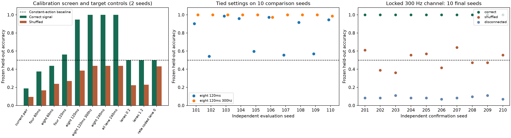
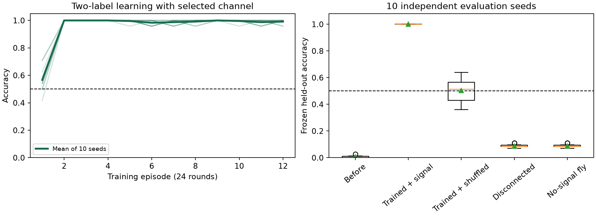

# Isolated teacher-to-student channel calibration

This report is **Stage 1** of the follow-up RPS study. The screen and
tied-setting comparison were completed before the plateau and teaching
experiments; an untouched confirmation was added during the final validity
audit. The calibration changes only a separate
diagnostic runner; the connectome file, neural simulation, `RpsBioRL` decision
rule, and dopamine-gated KC→MBON update are unchanged.

## Task and stopping rule

Each 400 ms round has a balanced random label, 0 or 1. Only a stimulation
pattern tells Fly B the label. Choosing the matching action earns +1; choosing
either other action, including action 2, earns -1. Each 24-round episode has
12 of each label. The usual RPS observation is absent. The original three-way
MBON argmax and dopamine learning are called at their usual 240 and 340 ms
times. The signal is an *artificial known label* for capacity testing, not a
claim about what Fly A knows.

The fixed search budget was eight main settings plus three target/encoding
controls, each screened on seeds 11 and 12 for 12 training episodes. Frozen
held-out tests used two new balanced episodes per calibration seed. The top
calibration scores tied; the shorter 120 ms, 150 Hz setting was compared
first, then the tied 120 ms, 300 Hz setting. Both used network seeds 101–110
and three new held-out episodes (72 rounds) per seed. Their outcomes informed
the choice of 300 Hz, so those seeds are called the **comparison set**.
The locked 300 Hz setting was then confirmed on **10 untouched seeds 201–210**.
No channel setting was selected using teaching results. The final channel setting for any
teaching test is **eight VPNs from each of lanes 0 and 1, one-hot stimulation at
300 Hz from 120 to 240 ms**.

The appropriate signal-independent benchmark is **50%**: a constant action 0
or 1 gets exactly 36/72 correct in every held-out sequence. We also ran the
actual unstimulated fly. On the untouched confirmation seeds it preferred
action 2 and scored only 8.8%; it made
no KC→MBON weight changes because no KC eligibility was generated. These are
different baselines and must not be conflated.

## Bounded calibration screen

Values are mean frozen held-out accuracy over the two calibration seeds. All
signals used distinct one-hot VPN patterns except the last row, which encoded
the two labels as 75 versus 300 Hz on the same VPN group.

| Target and pulse | Correct | Shuffled | Result |
|---|---:|---:|---|
| Lane 0/1, 2 VPNs each, 150 Hz, 60 ms | 18.8% | 9.4% | Failed |
| Lane 0/1, 4 VPNs each, 150 Hz, 60 ms | 37.5% | 16.7% | Failed |
| Lane 0/1, 8 VPNs each, 150 Hz, 60 ms | 43.8% | 24.0% | Failed |
| Lane 0/1, 4 VPNs each, 150 Hz, 120 ms | 56.3% | 27.1% | Weak |
| Lane 0/1, 8 VPNs each, 150 Hz, 120 ms | 94.8% | 38.5% | Passed calibration |
| Lane 0/1, 8 VPNs each, 300 Hz, 120 ms | 100% | 43.8% | Passed calibration |
| Lane 0/1, 8 VPNs each, 150 Hz, 240 ms | 100% | 43.8% | Passed calibration |
| Lane 0/1, 20 VPNs each, 150 Hz, 240 ms | 100% | 43.8% | Passed calibration |
| Lane 0/2, 8 VPNs each, 300 Hz, 120 ms | 50.0% | 22.2% | Failed |
| Lane 1/2, 8 VPNs each, 300 Hz, 120 ms | 50.0% | 22.9% | Failed |
| One group, 8 VPNs, rate code 75/300 Hz, 120 ms | 50.0% | 43.1% | Failed |

The lane 0/2, lane 1/2, and rate-code runs were diagnostic controls after the
original eight-setting screen; they did not change the locked evaluation
choice. VPN tags are artificial round-robin groups used by the RPS task, so
these comparisons do not imply that real flies use those particular neurons
for inter-fly communication.



## Comparison and independent confirmation

The table gives means across **10 seeds per row**, with 72 frozen held-out
rounds per condition and seed. The first two rows were used to choose between
calibration-tied settings. The final row is the untouched confirmation.
Evaluation copies only the student's own
learned multipliers into an otherwise fresh same-seed fly. The correct signal,
shuffled signal, and disconnected condition all use the same balanced label
sequences. Learning is disabled in evaluation.

| Seed set and setting | Before training | Correct signal after | Shuffled after | Disconnected after | Lowest correct-signal seed |
|---|---:|---:|---:|---:|---:|
| Comparison 101–110: 8 VPNs, 150 Hz, 120 ms | 5.8% | 79.4% | 41.4% | 10.1% | 54.2% |
| Comparison 101–110: 8 VPNs, 300 Hz, 120 ms | 1.3% | 99.6% | 52.4% | 10.1% | 97.2% |
| **Confirmation 201–210: 8 VPNs, 300 Hz, 120 ms** | **0.6%** | **100%** | **50.4%** | **8.8%** | **100%** |

In the untouched confirmation, all 10 seeds scored 100% with the correct
signal. The paired correct-minus-shuffled difference averaged 49.6 percentage
points (shuffled seed SD 9.6 points). The selected setting changed
1,224–1,372 plastic KC→MBON multipliers per seed through the unchanged
dopamine rule. Training accuracy averaged 56.7% in episode 1 and 100% in
episode 2; held-out tests,
not training scores, support the decoding claim.



## Where the information appears

With the selected setting, the correct signal reached the assigned VPNs:
their two target groups averaged about 181 versus 15 target spikes for label 0,
and 0 versus 182 for label 1; the extra label-0 group activity is downstream
or recurrent activity, not direct drive. The
mean KC spike counts at decision time were 240 for label 0 and 61 for label 1;
about 92 versus 79 KCs had nonzero eligibility traces. Mean MBON action-group
rates also differed: `[3.00, 1.90, 1.66]` for label 0 and
`[0.38, 1.56, 0.66]` for label 1. After training, the action distributions
were label 0: `[360, 0, 0]` and label 1: `[0, 360, 0]` over 360 held-out
rounds of each label. The induced activity is therefore distinguishable at
the KC, MBON, and action levels. The raw KC ensembles were not decoded by an
external classifier.

## Teacher-source normalization remains a separate issue

The successful capacity test injects a known one-hot label. It does **not**
show that the existing three Fly A source neurons carry a useful teaching
message. A replay of the saved seed-1 teacher matched all 72 published
quantized messages. Counts of at least 2, which the current `min(2, count)`
rule collapses, occurred in 43, 39, and 41 rounds by source; counts above 2
occurred in 33, 28, and 30 rounds. The first two raw counts tied in 45/72
rounds. A simple comparison of those sources would therefore often convey
no contrast. Across the original three-seed messages, 81.8% of noninitial
vectors were all zero or all maximum; the previous-move-conditioned next-move
information test was indistinguishable from its permutation control.

This identifies clipping and correlated sources as likely limits of the
*teacher-message content*. Source-specific normalization should be fixed from
neural activity on calibration data and audited for information before a
teaching test. This stage did not tune source normalization against teaching
outcomes or claim that the teacher can transmit the winning action.

An outcome-blind comparison on those 72 raw vectors found the current
three-source cap-at-2 code had **8 observed patterns, 1.78 bits of pattern
entropy, and a 54.2% modal pattern**. Raising the cap to 4 would have yielded
22 patterns and 3.46 bits, while a binary nonzero code would have yielded
4 patterns and 1.21 bits. Comparing the first two raw source counts gave a
tie on 62.5% of rounds. More pattern entropy is not evidence of more useful
task information; these are descriptive quantizer checks only. The separate
teaching test used a fixed source-0 zero/nonzero bit sampled at 120 ms, with
the strong two-pattern target code validated above.

## Reproduce and limitations

```text
node tools/calibrate_rps_channel.mjs screen
node tools/calibrate_rps_channel.mjs evaluate
node tools/calibrate_rps_channel.mjs evaluate eight_120ms_300hz
node tools/calibrate_rps_channel.mjs confirm
node tools/calibrate_rps_channel.mjs target_controls
node tools/audit_rps_channel_sources.mjs
python tools/analyze_rps_channel_normalization.py
python tools/plot_rps_channel.py
python -m unittest flyhero.test_rps -q
```

The complete per-seed measurements are in
`data/rps_channel_calibration.json`,
`data/rps_channel_evaluation.json`,
`data/rps_channel_evaluation_eight_120ms_300hz.json`,
`data/rps_channel_confirmation.json`,
`data/rps_channel_target_controls.json`, and
`data/rps_channel_source_audit.json`, and
`data/rps_channel_normalization_audit.json`. The synthetic labels prove that the
interface and reward rule *can* learn a limited code under strong, extended
stimulation. They do not establish useful Fly A→Fly B teaching or biological
inter-fly signaling. The 10-seed result is precise for this simulated task,
but the target selection and pulse parameters are still model-dependent.
