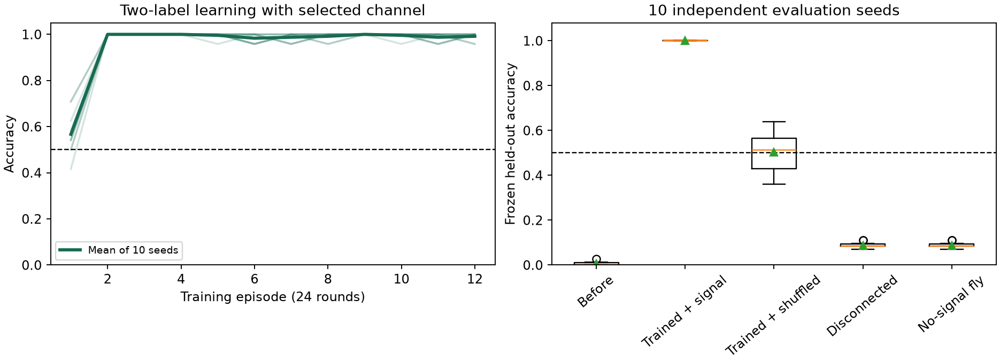
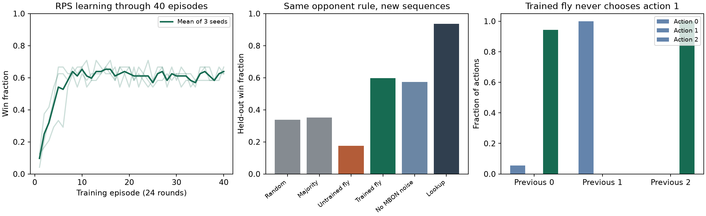
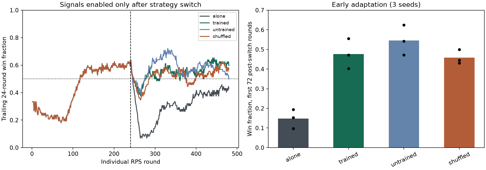

# Synapse RPS follow-up: channel, plateau, and teaching

The work followed the requested order: **(1) calibrate decoding, (2) diagnose
the original 61% plateau, (3) test teaching only after decoding succeeded,
(4) audit validity**. The audit added an untouched 10-seed channel confirmation
after the teaching run without changing the locked channel. The existing connectome, neural dynamics, dopamine
learning rule, original browser demo, and earlier result files were left
unchanged. New experiments live in separate scripts, JSON files, and reports.

## Findings at a glance

| Question | Measured result | Interpretation |
|---|---|---|
| Can Fly B learn a known two-label message? | **100%** held-out with the selected 8-VPN, 300 Hz, 120 ms channel across **10 untouched confirmation seeds**. Shuffled: **50.4%**. | Yes, the existing connectome and dopamine learning rule can learn this synthetic channel code. |
| Did weaker settings work? | The original two-VPN, 60 ms setting scored **18.8%** on two calibration seeds. Different target pairs and a single-group rate code scored **50%**. | Target choice, pulse width, and code matter. Failed settings were retained. |
| Why does original RPS stay near 61%? | After 40 episodes, **59.7%** held-out versus **93.5%** for a training-fitted lookup using the same previous-move observation. For previous move 2, the fly chose the wrong action in all 67 held-out rounds. | The action-1 MBON readout is rarely chosen or updated; the observation contains far more usable information than the fly extracts. |
| Does trained Fly A teach Fly B on a strategy switch? | On independent seeds 21–23, with signals enabled only after the switch, first-72-round wins: alone **14.8%**, trained **47.7%**, untrained **54.6%**, shuffled **45.8%**. Frozen disconnected: **38.9%, 44.9%, 42.1%, 40.7%**. | Stimulation helps adaptation, but the trained teacher did not reliably outperform the untrained and shuffled controls. |

Details, per-seed values, methods, and figures:

- [Channel calibration and source audit](channel-calibration.md):
  
- [Original RPS plateau](rps-plateau.md):
  
- [Independent-seed strategy-switch teaching](teaching-switch-final.md):
  

## Experimental limits and uncertainty

The channel search used a **fixed budget of eight settings plus three
diagnostic target/encoding controls**, screened on seeds 11 and 12. Two
calibration-tied settings were compared on seeds 101–110; those outcomes
helped choose 300 Hz. The locked choice was then confirmed on untouched seeds
201–210, all of which reached 100% correct-signal accuracy. Correct-minus-
shuffled accuracy averaged 49.6 points (seed SD 9.6). These numbers concern
the isolated synthetic
decoding task, where a known label was supplied; they do not measure teacher
quality.

The original RPS plateau analysis used seeds 1–3; the final teaching
comparison used separate seeds **21–23**. The teaching experiment had 72
held-out rounds per seed.
This is enough to show large neural stimulation effects and the obvious
RPS action-1 failure, but too little to make a precise claim about a small
teacher-specific advantage. The calibrated wide channel also required
reserving eight VPNs per target group from ordinary observations in the isolated
switch test. Ordinary input started at index 8 in all three lanes, so lane
2's first eight VPNs were unused as well. All student controls used the
same input reduction, but its
alone baseline is not directly comparable with the original browser task.

## Scientific validity audit

| Check | Evidence and status |
|---|---|
| Independent brains | Teacher and student are separate `Network` and `RpsBioRL` instances with separate state, randomness, and plastic multipliers. Only sampled integer activity labels pass between them. **Pass.** |
| Training/evaluation separation | Calibration seeds 11–12, tied-setting comparison seeds 101–110, untouched confirmation seeds 201–210, and final teaching seeds 21–23 are disjoint. The exploratory seed-1–3 teaching run is labeled separately. Frozen held-out sequences use distinct opponent seeds; evaluation has learning disabled. **Pass.** |
| Teacher information access | Actual teaching sends one intermediate-neuron spike count sampled at 120 ms, before the opponent acts at 240 ms. Fly A was pretrained on the future offset +2 task, so it has prior experience unavailable to Fly B; it has no current-move or explicit rule input during transmission. **Documented design choice.** |
| Answer leakage | The known label in Stage 1 deliberately reveals the rewarded action and is never used as a teacher signal. Stage 3's signal is derived only from Fly A neural activity. **No code path found that transmits the future move or correct action in Stage 3.** |
| Original plasticity | Stage 1 changed 1,240–1,612 KC→MBON multipliers per seed through `BioRL.afterDopamine`; Stage 2 measured action-specific changes. No external decoder or weight transfer is present. **Pass.** |
| Real connectome control | In the independent-seed switch run, real wiring with trained signals had 49.1% mean frozen wins versus 31.9% with shuffled wiring. The earlier original-task 12-episode control was 61.1% real versus 33.8% shuffled. **Real wiring matters for performance; this does not prove teaching.** |
| Simple non-neural explanation | A lookup policy using the same visible previous move scored 93.5% on held-out RPS, above the fly's 59.7%. Final-seed trained messages carried no detected extra next-move information after conditioning on visible context (`p≈0.96` against within-context shuffles). **Teaching benefit remains unproven.** |
| Visualizations | New plots read saved per-round simulation JSON. The existing browser brain animation reads `net.lastSpike`; its chart reads live episode win rates or saved `data/rps_results.json`. **No fabricated activity identified.** |

The code audit found **no implementation bug** warranting a change to the
connectome, dynamics, action rule, or dopamine rule. The original RPS
action-1 starvation is a limitation of the current readout and learning
protocol. The actual teacher source still appears largely redundant with
the previous-move observation; the strong synthetic decoding result does not
fix its message content.

## Changes and reproduction

New experiment scripts: `tools/calibrate_rps_channel.mjs`,
`tools/audit_rps_channel_sources.mjs`,
`tools/analyze_rps_channel_normalization.py`, `tools/diagnose_rps_plateau.mjs`,
`tools/probe_rps_action_updates.mjs`, `tools/test_rps_teaching_switch.mjs`,
and `tools/analyze_rps_teacher_signal.py`. Three plotting scripts generated
the PNG figures under `docs/rps-diagnostics/`. Results were saved under
distinct `data/rps_channel_*`, `data/rps_plateau_*`, and
`data/rps_teaching_*` filenames. Final teaching files include `_final` in
their names; the original seed-1–3 run is retained as exploratory. The stage
reports list exact commands.
No existing diagnostic result file was overwritten. Work was kept in separate
files in the current working tree; it was not moved to a new branch because
the workspace already contained uncommitted experiment and UI changes.

After the major stages, the six RPS unit tests and the original rhythm-game
reference suite passed, including Python/JavaScript spike parity. The script
syntax checks and saved-artifact audit also passed, including disjoint channel
seed sets and complete 480-round teaching records.

## Recommended next step

Keep the calibrated target interface and the negative teaching result as a
baseline. If the teaching question remains important, select Fly A source
neurons and normalize their activity using **separate neural calibration
data**, then require that the resulting messages vary beyond the visible
previous move before another confirmatory teaching run. Freeze those choices
before testing on new seeds. A separate investigation could test whether a
biologically justified exploration policy resolves the action-1 RPS plateau;
that would be a new modeling assumption, not a bug fix.
