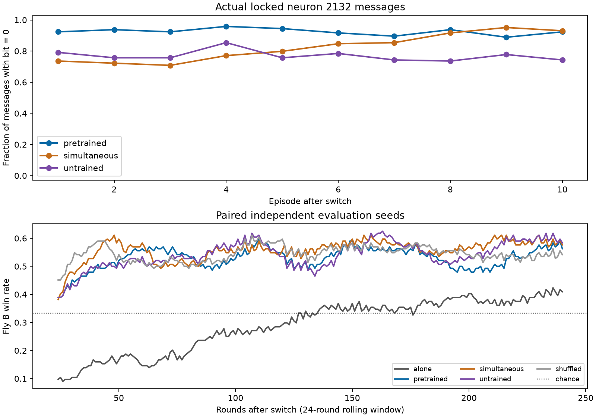

# Pretrained Fly A teaching through locked MBON 2132

## Question and protocol

This follow-up asks whether a Fly A that already knows the *new* RPS opponent strategy can help Fly B adapt at the switch. It uses the previously locked MBON neuron 2132, its existing 200 ms spike trace threshold of 0.5 at 120 ms, and the validated two-lane VPN channel (eight neurons per lane, 300 Hz, 120–240 ms). The connectome, neural simulation, and dopamine learning rule were not changed.

Every Fly B is trained without messages for ten 24-round episodes against the offset-1 previous-opponent strategy. The opponent then changes to offset 2 for ten episodes; each move has 10% random noise. The five post-switch conditions are:

1. **No teacher.**
2. **Pretrained teacher.** Fly A first trains for 20 independent episodes against offset 2, then its weights are frozen while it generates messages on the evaluation episodes.
3. **Simultaneous teacher.** Fly A trains on offset 1 before the switch, then learns offset 2 at the same time as Fly B.
4. **Untrained teacher.** Fly A's weights stay at initialization.
5. **Shuffled pretrained messages.** The same pretrained bit sequence is globally shuffled, retaining its label frequency.

The teacher's practice games use opponent seeds separate from the evaluation games. On each evaluation round, Fly A's bit is sampled at 120 ms; the current opponent move and reward are generated at 240 ms. The teacher stream can be replayed offline because this opponent depends on its own previous move, not on Fly B's action. Frozen-teacher weights are checked for exact equality before and after evaluation. For each condition, Fly B is restarted from the same seed and repeats the same ten pre-switch episodes. The code checks identical pre-switch actions, rewards, and synaptic-weight hashes. The student receives messages only after the switch.

Evaluation uses independent seeds **101–106**. Seed 100 was a code-check pilot and is excluded from all final estimates. Win rates are reported after 24, 72, and 240 post-switch rounds, plus five held-out 24-round games per seed with Fly B's learning frozen and the teacher disconnected. Uncertainty uses paired bootstrap resampling of the six **seeds**, not individual rounds. RPS chance win rate is 33.3%.

## Diagnostics

The source audit uses the actual bit recorded on every post-switch round. It measures bit frequency, information about the winning action, and information about Fly A's own action. Conditional information tests account for Fly B's previous-move observation, seed, and, separately, Fly B's previous reward. The null distribution shuffles bits within the corresponding observation categories. The winning action is computed after the opponent's move for analysis only; it is never sent through the channel.

Fly B's natural trials log target VPN spikes, KC activity, MBON output rates, actions, and rewards. A paired **frozen probe** uses Fly B's exact weights immediately before and after post-switch training. For each previous-move input, it presents both bit values observed in the real teacher stream with paired random seeds, then compares KC population spikes, MBON outputs, and actions. This probe does not deliver rewards or modify weights. It tests the effect of the channel without treating an offline analysis as a decoder for Fly B.

## Measured result: C

**C. The selected signal does not contain enough action-relevant information to help.** Pretraining made Fly A competent on the new strategy, and the channel strongly changed Fly B's neural and action outputs. The message itself was mostly constant or repeated an observation Fly B already had. Pretrained messages did not beat every control in early adaptation and left no advantage when disconnected. This result does **not** establish that Fly B is incapable of using a useful *natural* teacher message; this particular bit did not supply one in these rounds.



### What the frozen teacher sent

Across the six evaluation seeds, frozen pretrained Fly A won **65.3%** of its own post-switch games; five seeds were near 60–62% and one reached 87.5%. Its weights remained exactly unchanged. The bit from neuron 2132 was **0 on 1,332/1,440 rounds (92.5%)**. Of the 108 rounds with bit 1, **60 were the first round of an episode**, when the previous-move observation is absent. On the other 1,380 rounds, bit 0 appeared **96.5%** of the time. In particular, it appeared on all **463/463** rounds following previous move 0. The bit's total entropy was 0.384 bits, but only **0.185 bits** remained after the previous-move observation was known.

| Fly A source | Own post-switch win rate | Fraction of messages with bit 0 |
|---|---:|---:|
| Pretrained on new strategy, frozen | 65.3% | 92.5% |
| Adapting simultaneously | 47.0% | 82.4% |
| Untrained, frozen | 50.3% | 77.0% |

The pretrained bit had **0.0109 bits** of information about the winning action before accounting for observations (permutation p = 0.002). That apparent information disappeared when the previous opponent move was included: **0.0051 bits** after conditioning on previous move and seed, below the shuffled 95th percentile of 0.0113 bits (p = 0.687). After also conditioning on Fly B's previous reward, it was **0.0047 bits**, below a 0.0127-bit shuffled threshold (p = 0.898). Its association with Fly A's own chosen action, conditional on previous move, was also tiny: **0.0021 bits** (p = 0.204). The six seed-level conditional winning-action estimates ranged from 0.0002 to 0.0125 bits.

These measurements are made on the **exact 240 post-switch rounds per seed** when Fly B could receive the bit. In this fixed offset-2 regime, the previous move already predicts the usual next move; the remaining random deviations are drawn after the teacher's 120 ms sample. The earlier phase-wide finding for neuron 2132 therefore does not imply a useful per-round action message from a pretrained teacher.

### Fly B performance and learning speed

The intervals below are 95% bootstrap intervals over the six paired seeds. The first 24 and 72 rounds measure early adaptation; the 240-round rate and [round-level plot](pretrained-teacher-focus.png) show the learning course. Frozen disconnected testing uses five new 24-round games per seed.

| Fly B condition | First 24 rounds | First 72 rounds, 95% interval | All 240 rounds | Frozen disconnected, 95% interval |
|---|---:|---:|---:|---:|
| No teacher | 9.7% | 15.3% [13.7, 17.1] | 28.7% | 39.6% [37.9, 41.3] |
| Pretrained teacher | 38.9% | 48.6% [45.8, 50.9] | 52.1% | 36.1% [34.7, 37.2] |
| Simultaneous teacher | 38.2% | 50.0% [47.2, 53.2] | 54.9% | 35.4% [33.3, 37.5] |
| Untrained teacher | 38.9% | 47.2% [43.5, 50.9] | 53.5% | 34.9% [31.7, 38.2] |
| Shuffled pretrained bit | **45.1%** | **50.9% [48.6, 53.7]** | 53.8% | 37.9% [35.8, 39.6] |

Paired first-72-round differences for **pretrained minus control** were **+33.3 percentage points** versus no teacher [29.6, 36.8], **−1.4** versus simultaneous [−6.0, 2.8], **+1.4** versus untrained [−2.8, 5.3], and **−2.3** versus shuffled [−4.2, −0.5]. Frozen disconnected performance was **3.5 points lower** than no teacher [−5.6, −1.5] and **1.8 points lower** than shuffled [−3.1, −0.6]. Thus the large difference from no teacher is consistent with generic stimulation disrupting Fly B's poor old-strategy policy; it is not a trained-teacher effect. Six seeds limit precision for small effects, but the pretrained condition does not meet the requested comparison against every control.

For a stricter recovery measure, a moving 72-round win rate had to reach at least 50% and stay there for the next 72 endpoints. Recovery rounds for pretrained were **86, 72, not reached, 135, 72, 72**; for simultaneous they were **72, 88, 72, 124, 79, 72**. No-teacher students did not reach this criterion on any seed. The pretrained teacher was not consistently fastest.

### Could Fly B respond to and learn from the bit?

In natural pretrained-message trials, bit 0 drove about **182 versus 18** spikes in the two reserved VPN target groups; bit 1 drove about **0 versus 182**. KC spike totals averaged **71.5 versus 64.6**, and MBON group rates also differed. Because the rare bit is tied to the first round and other observations, these natural activity differences alone do not isolate the message's effect.

The paired frozen probe does isolate it. With Fly B's *same pre-switch weights*, previous-move input, and paired random seeds, changing only the channel bit changed an average **137 KC population spike counts**, the three MBON rates by a combined Euclidean distance of **0.90**, and Fly B's chosen action on **66.7%** of trials [64.1, 69.2]. After Fly B had trained on the actual recorded messages, the two bit values still changed actions on **40.0%** of paired trials [34.5, 45.8]; KC and MBON differences remained measurable. The post-training probe chose the deterministic new-strategy winning action on **58.6%** of bit-0 and **53.2%** of bit-1 trials. It did not develop a useful bit-specific action rule. The [probe plot](pretrained-teacher-probe.png) shows these before/after changes.

In natural trials, Fly B's action was associated with the pretrained bit after previous move and seed were accounted for (**0.021 bits**, permutation p = 0.002). The same check was **0.042 bits** for shuffled bits (p = 0.002), so action distinguishability is not evidence of useful teaching. The two values reach KC and MBON pathways and can change choices; the failure is that this real message does not reliably identify which choice will win.

The conditional request for a reward-based decoding diagnostic using actual teacher signals was **not triggered**: the pretrained source had no detectable winning-action information beyond Fly B's available previous-move and previous-reward observations. A task that rewarded an action simply for matching this mostly constant bit would test an imposed bit-to-action rule rather than whether Fly A taught the RPS strategy. We therefore used the actual recorded bit values in the paired neural probe and did not invent an oracle message or train an external decoder.

## Proposed simpler transfer task (not implemented)

Use a **balanced two-cue, two-action reversal task** on the same connectome and dopamine learning rule. Present visual cue 0 or 1 equally often through the existing VPN inputs. Each block has one of two cue-to-reward mappings, chosen independently across blocks. Let Fly A learn the new mapping before Fly B does; both then see the same cue, and Fly A sends only its measured neuron activity through the locked channel. The third RPS action, if selected by the existing three-action readout, simply receives the ordinary incorrect-action reward. Include untrained, shuffled, and no-teacher controls.

This removes the noisy next-move prediction problem and gives the teacher an opportunity to convey a learned cue–action mapping that varies on individual trials. Randomizing the mapping across blocks makes it possible to test whether the message adds information about the correct action **given the cue**, instead of merely marking elapsed training time or a constant strategy phase. Before a teaching run, that conditional information should be demonstrated on calibration blocks and the source choice locked for untouched evaluation blocks. No version of this alternative task has been run or implemented here.

## Validation and limits

`python -m unittest flyhero.test_rps -v` passed all **six** existing RPS tests. `python -m flyhero.test` passed its original neuron, wiring, game, browser parity, and learning checks. The new JavaScript files passed `node --check`, and the Python analysis file passed a syntax check. Every evaluation run asserted identical Fly B pre-switch action/reward histories and synaptic-weight hashes across conditions, unchanged frozen Fly A weights, unchanged frozen evaluation weights, and identical opponent moves across teacher streams. The after-training probe reproduced Fly B's saved actions and rewards before testing its frozen weights.

Six seeds and five held-out games per seed still leave uncertainty about small performance differences. The result establishes the limitation of **this locked source bit in this RPS protocol**. It does not rule out other informative Fly A neurons, richer natural activity codes within the same bandwidth, or a different task. The paired bootstrap intervals describe variability across these six simulation seeds; they do not turn all rounds within a seed into independent experiments.

## Reproduction

The raw per-seed records are `data/rps_pretrained_teacher_101.json` through `data/rps_pretrained_teacher_106.json`. Paired probes are `data/rps_pretrained_channel_probe_<seed>.json` and `data/rps_pretrained_channel_probe_<seed>_after.json`. The [summary JSON](../../data/rps_pretrained_teacher_summary.json) holds all derived measurements and seed-level intervals. The plots are generated by the analysis script.

From a copy of this workspace with `data/rps_teacher_source_lock.json` preserved and without these generated result files, run:

```powershell
foreach ($s in 101,102,103,104,105,106) {
  node tools/test_rps_pretrained_teacher.mjs $s
  node tools/probe_rps_pretrained_channel.mjs $s before
  node tools/probe_rps_pretrained_channel.mjs $s after
}
python tools/analyze_rps_pretrained_teacher.py 101 102 103 104 105 106
python -m unittest flyhero.test_rps -v
python -m flyhero.test
```

The runners refuse to overwrite raw results. The code is in [the teaching runner](../../tools/test_rps_pretrained_teacher.mjs), [paired probe](../../tools/probe_rps_pretrained_channel.mjs), and [analysis script](../../tools/analyze_rps_pretrained_teacher.py).
