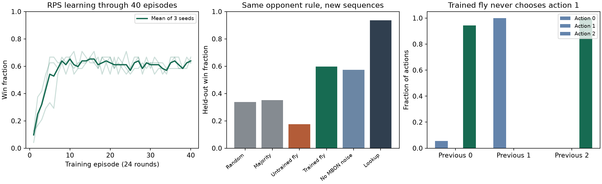

# Why the original RPS fly stays near 61%

This is **Stage 2**, performed after the channel capacity test was saved. It
uses the existing RPS opponent, unchanged connectome and learning mechanism,
40 training episodes of 24 rounds, and three independent seeds. Frozen
evaluation uses three new 24-round sequences per seed. The simple policies
use only the previous opponent move that the fly receives. All results below
are measured simulation results unless explicitly called an inference.

## Held-out comparison

| Policy or intervention | Mean wins over three seeds |
|---|---:|
| Random action | 33.8% |
| Best constant action estimated from training moves | 35.2% |
| Untrained fly, learning off | 17.6% |
| Fly after 40 episodes, learning off | **59.7%** |
| Same trained fly, MBON noise disabled only for evaluation | 57.4% |
| Lookup table fitted on training previous-move → next-move counts | **93.5%** |

The three trained-fly held-out rates were each 43/72 = 59.7%. The final ten
training episodes averaged 61.0%. The earlier 20-episode diagnostic had
60.6% held-out wins; doubling training to 40 episodes did not close the gap.
The lookup policy shows that the one-move observation carries almost all the
needed information. The 10% opponent noise limits an exact deterministic
rule, but not to 61%. The existing 12-episode shuffled-connectome control
finished at 33.8% held-out, versus 61.1% for the real-wiring student; that
control used a shorter training horizon and is not the 40-episode comparison.



## Where the fly loses

The opponent usually increments its previous move. Thus previous 0 calls for
action 2, previous 1 calls for action 0, and previous 2 calls for action 1.
The trained fly's frozen held-out actions and wins were:

| Previous opponent move | Held-out rounds | Action counts [0, 1, 2] | Win rate |
|---|---:|---|---:|
| 0 | 71 | [4, 0, 67] | 90.2% |
| 1 | 69 | [69, 0, 0] | 91.3% |
| 2 | 67 | [0, 0, 67] | **0%** |

The responses are consistent for each repeated observation. They are
appropriately distinct for previous moves 0 and 1. For previous move 2, the
fly consistently selects action 2 rather than action 1. The three MBON
groups are therefore not functionally interchangeable under this task.

## Action-selection and plasticity evidence

Over each seed's 960 training rounds, the fly chose action 1 only **18, 19,
and 16 times**, versus hundreds of choices for actions 0 and 2. After 40
episodes, its action-1 KC→MBON group had **108, 109, and 109** changed
plastic multipliers, compared with 244–350 in group 0 and 378–546 in group
2. The rule in `RpsBioRL.decide` selects the maximum MBON group; its
eligibility snapshot and `BioRL.afterDopamine` update only the *selected*
group. The measured lack of action-1 choices therefore limits its chances
to acquire useful action-1 plasticity. This is the strongest explanation of
the plateau. It is a property of the current readout and reward policy, not
evidence of an implementation bug.

Disabling MBON noise during frozen evaluation changed the mean from 59.7% to
57.4%, so that noise is not the main cause. An exploratory argmax read at
180 ms would have won 58.3% (first-index tie breaking), close to the real
240 ms decision's 59.7%; this does not rule out every possible timing change,
but gives no evidence that the 60 ms difference explains the 30-point gap.
Plastic weights continued to change through episode 40, so learning had not
numerically stopped. It was updating the wrong distribution of actions.

## Interpretation and next step

The observation is encoded well enough for the fly to learn two mappings;
the lookup table and the two roughly 90% observation-specific win rates show
that information leakage is not needed to explain learning. The action-1
group is starved under the existing deterministic MBON argmax. One could
diagnose this further with a controlled exploration intervention, but changing
the action policy merely to raise RPS performance would change the current
biological modeling assumptions. No neural or action-selection code was
modified here.

Reproduce with:

```text
node tools/diagnose_rps_plateau.mjs
node tools/probe_rps_action_updates.mjs
python tools/plot_rps_plateau.py
```

Complete per-seed and per-observation measurements are in
`data/rps_plateau_diagnostics.json` and
`data/rps_plateau_action_updates.json`. Only three network seeds were used
for this stage; the strong consistency of the failure supports the diagnosis,
but does not establish how other connectome extracts or learning policies
would behave.
