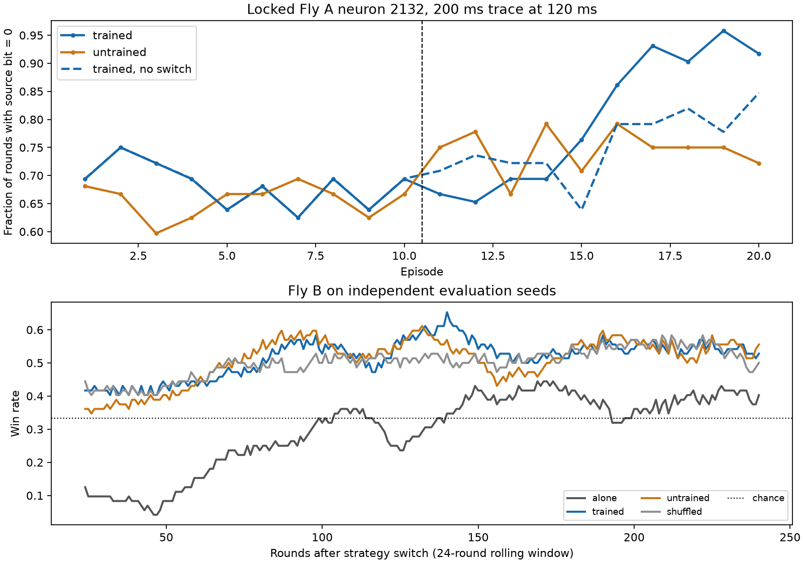

# Fly A neural activity and the locked-source teaching test

## Result

Fly A's learned neural activity **does contain information about the changed opponent strategy**. A one-bit reading of MBON neuron **2132** carried **0.152 bits** about the opponent's next move beyond the previous move on three independent evaluation seeds. The same reading from untrained Fly A carried **0.013 bits**. This information is almost entirely a cue about which strategy phase the opponent is in; it does not predict the opponent's random deviations within a phase. The cue becomes strong only about five to six episodes after the switch.

Sending that bit through the previously validated VPN channel **did not give Fly B a teacher-specific benefit**. Shuffled and untrained teacher messages performed as well or better in the early post-switch period. Stimulation itself changes Fly B's actions and helps it escape a poor pre-switch policy, which explains why any-message conditions can look better than no teacher.



## Protocol and selection

Each episode has 24 RPS rounds. Fly A trained for 12 episodes against the offset-1 previous-opponent strategy. During the 20 recorded episodes, that strategy ran for episodes 1–10 and changed to offset 2 for episodes 11–20, with 10% random moves. Trained Fly A continued the existing dopamine-based learning; this diagnostic differs from the earlier frozen-teacher switch test so that neural adaptation to the switch can be observed. Untrained Fly A had the same opponent observations and opponent moves, but no learning. Activity was sampled at **120 ms**, after the previous move's visual input and before the current action (240 ms), opponent move, and reward. Thus the current move is unavailable at sampling time. The recordings cover all 3,275 brain neurons outside the VNC; the source search considered 1,167 mid, MBON, DN, PAM, and PPL1 neurons, each with three prespecified one-bit activity readings.

Seeds **41–43** were used only to rank sources. The rule chose the largest trained-minus-untrained increase in `I(source bit; next opponent move | previous opponent move)` among readings active on 10–90% of rounds and with a positive increase on each calibration seed. This locked **MBON 2132, trace ≥ 0.5 at 120 ms**. The trace is the existing 200 ms spike trace. A bit of 0 stimulates the first eight VPN neurons in lane 0; otherwise it stimulates the first eight in lane 1, at 300 Hz from 120 to 240 ms. No opponent move, strategy label, action, synaptic weight, or fitted decoder is transmitted. The original connectome, neural dynamics, and dopamine learning rule were not edited.

Seeds **61–63** were untouched until after [the source lock](../../data/rps_teacher_source_lock.json) was saved. Student tests used the same opponent seeds and student initialization in all conditions. In the **full** test, messages arrived throughout training. In the **post-only** test, messages started at the strategy switch; all students had exactly identical actions and rewards before that point. The comparison includes no teacher, trained Fly A, untrained Fly A, and a global permutation of the trained Fly A bits. The permutation retains the bit frequency while breaking its alignment with rounds and strategy phase.

## What Fly A activity represents

The table gives representative one-bit readings ranked on calibration seeds. Information is in bits; “given previous move” removes the observation already shown to Fly B. These are associations, not claims that a single neuron stores a complete strategy.

| Association | Example neuron and reading | Trained | Untrained | Interpretation |
|---|---|---:|---:|---|
| Previous opponent move | MID 2441, any spike | 0.908 | 0.900 | Mostly encodes current visual input; learning adds little. |
| Fly A's upcoming action, given previous move | MBON 2108, any spike | 0.125 | 0.001 | A learned action correlate, sampled before the decision. |
| Previous reward, given previous move | MBON 2145, trace ≥ 1.5 | 0.435 | 0.641 | Reward history is visible even without training; not a learned-strategy source by itself. |
| Strategy phase, given previous move | MID 2577, trace ≥ 0.5 | 0.426 | 0.436 | Strong phase association that is equally present untrained. |
| Next move, given previous move | **MBON 2132, trace ≥ 0.5** | **0.190** | **0.024** | Largest calibration gain, +0.166 bits; positive on all three seeds. |

On the independent evaluation seeds, locked MBON 2132 gave:

| Measurement | Trained | Untrained |
|---|---:|---:|
| Information about next move given previous move | **0.152 bits** | 0.013 bits |
| Information about next move given previous move **and actual strategy phase** | 0.002 bits | 0.006 bits |
| Information about strategy phase given previous move | **0.194 bits** | 0.013 bits |
| Information about Fly A's action given previous move | 0.056 bits | 0.003 bits |
| Information about previous reward given previous move | 0.260 bits | 0.163 bits |

The trained next-move gain over untrained was **0.167, 0.160, and 0.093 bits** on seeds 61, 62, and 63. Shuffling the locked activity within each previous-move category produced a 95th-percentile null of 0.006 bits; trained activity was above it (500 permutations, p = 0.002). When the student's own previous move **and previous reward** are accounted for, the trained source still has 0.101 bits of additional next-move association (permutation null 95th percentile 0.010 bits, p = 0.002). This does not establish information beyond Fly B's entire longer history or learned weights.

The key timing limitation is visible in the source itself. The bit was active on **67.6%** of rounds in the last three pre-switch episodes and **67.1%** in the first three post-switch episodes. It rose to **92.7%** in episodes 17–20. Trained Fly A's mean win rate fell from about **60.6%** in the last three pre-switch episodes to **34.7%** in the first three after the switch, then recovered to **57.9%** in the last three. Untrained Fly A won **47.7%** of the first three post-switch episodes, since the new strategy happened to suit its untrained action bias better. The selected source tracks late adaptation more clearly than early detection.

Two further controls limit the interpretation:

- With shuffled brain wiring, the same numbered MBON's trained next-move information was **0.004 bits**, compared with 0.002 untrained, on one control seed. This supports a role for the real wiring, but one seed is not a general wiring result.
- In a trained **no-switch** control, the source also drifted upward late: its activity was **80.9%** in episodes 17–20, versus **92.7%** after the real switch. Pre-switch bit sequences matched the switched recordings exactly. Thus part of the phase association is ordinary continued training or time, and the extra 11.8 percentage points after the switch is consistent with a strategy-dependent response. It is not proof that the neuron explicitly represents the hidden strategy.

## Did Fly B use the signal?

The table reports win rates averaged over three independent seeds. RPS chance win rate is **33.3%**. “Frozen disconnected” uses three new 24-round offset-2 tests per seed, with student learning off and no teacher signal. Early measurements use the first 24 or 72 rounds after the switch.

| Delivery | Condition | First 24 post-switch | First 72 post-switch | Frozen disconnected |
|---|---|---:|---:|---:|
| Full | No teacher | 12.5% | 13.9% | 41.2% |
| Full | Trained | 41.7% | 44.0% | 39.4% |
| Full | Untrained | 36.1% | 42.1% | 38.9% |
| Full | Shuffled trained | **44.4%** | **45.8%** | **46.8%** |
| Post-only | No teacher | 12.5% | 13.9% | 41.2% |
| Post-only | Trained | 29.2% | 42.6% | 38.9% |
| Post-only | Untrained | 34.7% | 44.4% | 39.4% |
| Post-only | Shuffled trained | **40.3%** | **47.2%** | 36.6% |

The **post-only** comparison is the clearest causal test because the pre-switch student histories are identical. In its first 72 post-switch rounds, trained messages won **92/216** rounds, untrained **96/216**, and shuffled **102/216**. Trained-minus-untrained differences by seed were **−2.8, 0.0, and −2.8 percentage points**. No condition established a durable teacher advantage after the teacher was disconnected.

The messages physically reached distinct target neurons: with trained messages throughout, the two reserved VPN groups averaged **182 versus 17 spikes** for label 0, and **4 versus 184 spikes** for label 1. Fly B's final action distribution also differed by label; its conditional action–bit association was **0.076 bits** in the full trained condition versus **0.034 bits** with shuffled messages. Because the real bit tracks training phase, that association alone does not show correct decoding. It shows that the source can alter the network and action output, while the reward-guided behavior still does not extract a teacher-specific benefit.

For an additional recovery measure, a student had to maintain at least **50% wins in a moving 72-round window** for 72 successive endpoints. The post-only recovery rounds were **106/80/78** for trained, **112/78/75** for untrained, **140/72/72** for shuffled, and **not reached** for no teacher. The trained teacher is not consistently fastest by this measure either. The 24-round rolling curves are in the figure above.

## Conclusion and next experiment

The current Fly A has a real, learning-associated one-bit signal about the strategy phase, but it emerges late and does not improve Fly B beyond untrained or shuffled stimulation. The data support **source timing and redundancy** as limitations; they do not establish a failure of the already validated VPN interface or justify changing the connectome or learning rule. The smallest next experiment would rank source bits specifically for **early, switch-dependent changes** on calibration seeds, include a matched no-switch control during selection, lock the source before evaluation, and rerun the same post-only paired student test. That is a proposal, not a positive teaching result from this run.

## Reproduction and files

- Recordings: [calibration analysis](../../data/rps_teacher_activity_calibration_analysis.json), [evaluation analysis](../../data/rps_teacher_activity_evaluation_analysis.json), [shuffled-wiring control](../../data/rps_teacher_activity_calibration_shuffled_analysis.json), and the per-seed compressed activity files in `data/rps_teacher_activity_*.json.gz`.
- Locked teaching results: [summary JSON](../../data/rps_selected_teacher_summary.json) and per-seed `data/rps_selected_teacher_{full,postonly}_{61,62,63}.json` files.
- Scripts: [record activity](../../tools/scan_rps_teacher_activity.mjs), [rank/analyze](../../tools/analyze_rps_teacher_activity.py), [no-switch control](../../tools/control_rps_teacher_noswitch.mjs), [student test](../../tools/test_rps_selected_teacher_source.mjs), and [summary/plot](../../tools/summarize_rps_selected_teacher.py).

To rerun in a fresh copy without generated result files, use these PowerShell commands. Verify that the top calibration reading agrees with `data/rps_teacher_source_lock.json` **before** executing the evaluation commands.

```powershell
foreach ($s in 41,42,43) { node tools/scan_rps_teacher_activity.mjs calibration $s }
node tools/scan_rps_teacher_activity.mjs calibration 41 shuffled
python tools/analyze_rps_teacher_activity.py calibration 41 42 43
python tools/analyze_rps_teacher_activity.py calibration 41 --shuffled

foreach ($s in 61,62,63) { node tools/scan_rps_teacher_activity.mjs evaluation $s }
python tools/analyze_rps_teacher_activity.py evaluation 61 62 63
foreach ($s in 61,62,63) {
  node tools/control_rps_teacher_noswitch.mjs $s
  node tools/test_rps_selected_teacher_source.mjs full $s
  node tools/test_rps_selected_teacher_source.mjs postonly $s
}
python tools/summarize_rps_selected_teacher.py
```

The recorders and student test reject overwriting raw results to protect the locked evaluation split.
