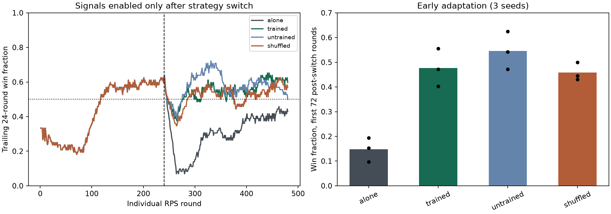

# Independent-seed strategy-switch teaching test

This is the **final Stage 3 test**, using seeds **21, 22, and 23**. They are
separate from channel-screen seeds 11–12, decoding-evaluation seeds 101–110,
and the earlier RPS/source exploratory seeds 1–3. The protocol and channel
were locked before inspecting these outcomes. The earlier
[seed-1–3 teaching run](teaching-switch.md) is preserved as exploratory.

## Protocol

The selected Stage 1 channel stimulates eight existing VPNs in each of two
groups at **300 Hz for 120 ms**, ending at Fly B's 240 ms decision. The
message is a fixed binary quantization of one Fly A intermediate neuron's
spike count at 120 ms: zero versus nonzero. It contains no explicit opponent
move, rule, teacher action, or synaptic weights. Fly A was pretrained for 20
episodes on the future offset +2 opponent; its last five training episodes
averaged 62.5% wins. Fly B played 10 episodes against offset +1, then 10
against offset +2, with 24 rounds per episode and 10% random opponent moves.
The teacher and student were separate network instances.

The calibrated target VPNs overlap the original previous-move input. In this
isolated script, the first eight VPNs of lanes 0 and 1 were reserved for the
message; ordinary previous-move input started at index 8 in **all three**
lanes for every student condition. Lane 2's first eight VPNs were unused,
which is a common input reduction rather than a channel target. Thus the
baseline differs from the original
browser experiment. The browser code and original results were not changed.

Conditions: alone (equivalent to a disconnected teacher), trained teacher,
untrained teacher with matched source randomness, trained messages shuffled
within each episode, and a shuffled-connectome student with trained messages.
The most controlled comparison turned messages on **only after the switch**;
its students had identical pre-switch actions, rewards, observations, and
weights. Frozen evaluation used three new 24-round post-switch sequences per
seed, with the teacher disconnected and learning disabled.

Recovery means the first post-switch trailing 72-round window with at least
50% wins that remained at or above 50% for another 72 windows. `none` means
that criterion was not met in the 240 post-switch training rounds.

## Measured results

All percentages below are means over **three independent network seeds**.
The first and last post-switch intervals each contain 72 rounds per seed.

| Signals throughout training | First 72 post-switch | Last 72 post-switch | Recovery rounds, seeds 21/22/23 | Frozen disconnected |
|---|---:|---:|---|---:|
| Alone/disconnected | 14.8% | 41.2% | none / none / none | 38.9% |
| Trained Fly A | 46.8% | 48.1% | none / none / none | 49.1% |
| Untrained Fly A | 41.2% | 49.5% | none / none / none | 49.1% |
| Shuffled trained messages | 44.0% | 57.9% | none / 166 / none | 51.4% |
| Shuffled wiring + trained messages | 32.4% | 32.4% | none / none / none | 31.9% |

| Signals only after switch | First 72 post-switch | Last 72 post-switch | Recovery rounds, seeds 21/22/23 | Frozen disconnected |
|---|---:|---:|---|---:|
| Alone/disconnected | 14.8% | 41.2% | none / none / none | 38.9% |
| Trained Fly A | 47.7% | 61.1% | 72 / 90 / none | 44.9% |
| Untrained Fly A | **54.6%** | 56.5% | 72 / 72 / 74 | 42.1% |
| Shuffled trained messages | 45.8% | 56.5% | 81 / 109 / none | 40.7% |

In the controlled post-switch-only comparison, trained messages produced
103 wins in the first 216 post-switch rounds, untrained 118, shuffled 99,
and alone 32. The trained group finished 2.8 percentage points ahead of
untrained in frozen held-out play, but with only 72 evaluation rounds per
seed and inconsistent recovery across seeds, that is insufficient to claim
a teacher-specific gain. The main run's frozen trained and untrained means
were identical at 49.1%, and shuffled was higher at 51.4%.



## Message content and neural effects

Trained Fly A sent 708 label-0 and 732 label-1 messages over 1,440 rounds;
its labels agreed with the matched untrained Fly A on **81.9%** of rounds.
After conditioning on the previous opponent move visible to Fly B and the
switch phase, the message had **0.0028 bits** of empirical next-move
information, versus a **0.0052-bit** median from 500 within-context
permutations (`p≈0.96`). We found no evidence of extra prediction in this
source stream. This test does not rule out a redundant cue that is easier for
Fly B to use.

The signal did physically enter the student. After the switch, the trained
condition averaged about **80.5 KC spikes per round** and differed from its
paired alone action on **110, 126, and 115** of 240 rounds by seed. Untrained
and shuffled streams caused similarly large KC and action changes. The
synthetic decoding success from Stage 1 therefore establishes channel
capacity, while this experiment shows that the chosen Fly A source does not
deliver a reliable *trained-teacher-specific* benefit.

## Interpretation and limitations

The original connectome, neural equations, MBON decision rule, and
dopamine-gated plasticity were left intact. A strong binary channel can make
the student adapt faster, but generic stimulation or redundant context
accounts for much of the effect. This is a **negative teaching result**, not
a channel-capacity failure. The sample has only three final seeds and cannot
exclude a small effect. The reserved-VPN input change, including unused
lane-2 VPNs, and Fly A's modest
~62.5% expertise are material limits. We did not tune the channel or source
threshold on these results.

Reproduce from the repository root:

```text
node tools/test_rps_teaching_switch.mjs final
node tools/test_rps_teaching_switch.mjs postonly_final
python tools/analyze_rps_teacher_signal.py final
python tools/plot_rps_teaching.py final
```

Per-round records and seed-level results are in
`data/rps_teaching_switch_final.json`,
`data/rps_teaching_switch_postonly_final.json`, and
`data/rps_teaching_signal_information_final.json`.
