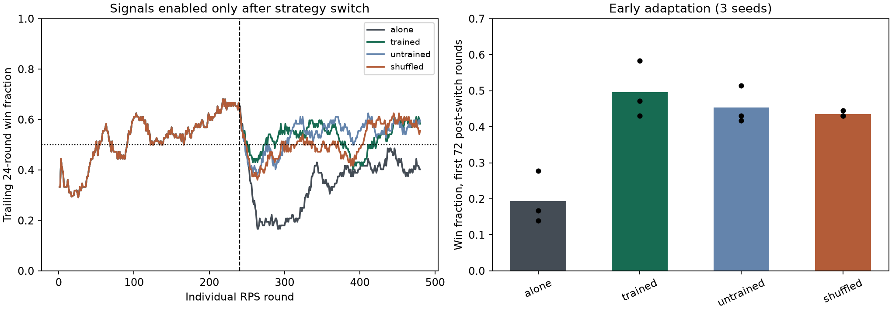

# Strategy-switch teaching with a calibrated neural channel

**Exploratory seeds 1–3.** These seeds overlap earlier source and RPS audits.
The locked-protocol [independent-seed teaching test](teaching-switch-final.md)
on seeds 21–23 is the final result; this report is retained to show the
earlier measurements and why they were not treated as confirmatory.

This is **Stage 3**, started only after the isolated two-label decoder passed
its 10-seed validation. It uses the selected one-hot channel: eight VPNs from
each of lanes 0 and 1 receive 300 Hz from 120 to 240 ms. The source is a
single real simulated Fly A intermediate neuron (`MID_SOURCES[0]`). Its spike
count at 120 ms is mapped to label 0 if nonzero and label 1 if zero. This is
a fixed, low-bandwidth activity quantizer; it does not inspect the opponent's
future move, rule, reward, or Fly A's weights. No decoder or weights are
copied into Fly B.

The wider calibrated channel would overlap the original visual input, which
used lane VPNs starting at index 2. In this **isolated experiment only**, the
first eight VPNs of lanes 0 and 1 are reserved for communication and the
ordinary previous-move observation begins at index 8 for every student
condition. The original RPS demo and original result files are unchanged.
This common input change lowers the alone baseline and prevents a direct
numerical comparison to the original 61% task.

## Protocol

Fly A was pretrained for 20 episodes on the post-switch `previous_opponent`
rule with offset +2 and 10% random move replacement. Its last five training
episodes averaged 62.8% wins across three seeds. Fly B then played 20
episodes of 24 rounds: offset +1 for episodes 1–10 and offset +2 for episodes
11–20. Fly A and Fly B were independent network objects. Trained and
untrained Fly A streams used matched source random seeds and the same opponent
sequences; student conditions used matched seeds and observations.

Conditions were alone/disconnected, trained source, untrained source, trained
source shuffled within each episode, and trained source into shuffled wiring.
The more controlled follow-up enabled signals **only after the switch**, so
the real-wiring students had identical pre-switch action, reward, and
observation histories. Frozen held-out tests used three new 24-round offset
+2 sequences per seed, no teacher signal, and no learning. The prespecified
recovery rule was the first trailing 72-round post-switch window with at
least 50% wins that stayed at or above 50% for the next 72 windows; `none`
means it was not reached within 240 post-switch rounds.

## Results

Means are over three network seeds. The first table reports the main run,
which had signals throughout training; the second is the post-switch-only
follow-up. `Frozen` is teacher-disconnected held-out accuracy.

| Main run | First 72 post-switch | Last 72 post-switch | Recovery rounds by seed | Frozen |
|---|---:|---:|---|---:|
| Alone/disconnected | 19.4% | 41.2% | none, none, none | 40.7% |
| Trained Fly A | 46.3% | 52.3% | 72, none, none | 47.2% |
| Untrained Fly A | 38.4% | 52.3% | 89, none, none | 44.0% |
| Shuffled trained stream | 40.3% | 56.0% | 145, 119, none | 46.3% |
| Shuffled wiring + trained stream | 31.5% | 34.7% | none, none, none | 31.9% |

| Signals only after switch | First 72 post-switch | Last 72 post-switch | Recovery rounds by seed | Frozen |
|---|---:|---:|---|---:|
| Alone/disconnected | 19.4% | 41.2% | none, none, none | 40.7% |
| Trained Fly A | **49.5%** | 56.9% | 72, 75, none | **44.4%** |
| Untrained Fly A | 45.4% | 56.9% | 72, 98, 108 | 43.1% |
| Shuffled trained stream | 43.5% | 57.9% | 163, 83, none | 41.2% |

For the post-switch-only follow-up, trained versus alone won 107 versus 42
of the first 216 post-switch rounds (three seeds × 72). Untrained won 98 and
shuffled won 94. The **trained-specific** advantage over untrained and
shuffled is therefore much smaller than the general effect of stimulation,
and the three-seed recovery ordering is not consistently favorable to the
trained teacher. The frozen trained-minus-untrained mean is 1.3 percentage
points, below the resolution warranted by 72 held-out rounds per seed.



## Message and neural audit

Across all three seeds, trained-source messages numbered 695 label-0 and
745 label-1 over 1,440 rounds. Trained and untrained message labels agreed
on **79.4%** of matched rounds. After conditioning on the visible previous
opponent move and switch phase, the trained binary message carried an
empirical **0.0063 bits** of next-move information per noninitial round,
versus a 0.0057-bit median from 500 within-context permutations
(`p ≈ 0.38`). This gives no evidence of extra future-move information.
It does not preclude a redundant cue being easier for a novice fly to use.

Delivery was strong: in the post-switch-only run, trained-signal rounds had
about 80 KC spikes per decision, versus 2.9 alone, and the student action
differed from the paired alone run in 109, 102, and 94 of the 240 post-switch
rounds by seed. Untrained and shuffled signals produced comparable neural
and behavioral effects. The useful **synthetic** code from Stage 1 therefore
does not imply that these particular teacher neurons provide a useful
teacher-specific message.

## Conclusion and limits

The calibrated stimulation interface can alter Fly B's learning and speed
post-switch adaptation, but this experiment does **not** demonstrate a
reliable teaching benefit from trained Fly A. An untrained teacher and a
temporal shuffle account for much of the improvement; frozen differences
are small and there are only three seeds. The current source quantizer mostly
encodes already-visible context. The reserved-VPN observation change is a
necessary interface accommodation and may itself affect the task. We did not
tune the selected channel against these teaching outcomes or alter the
connectome, neural equations, dopamine rule, or original demo.

Reproduce with:

```text
node tools/test_rps_teaching_switch.mjs
node tools/test_rps_teaching_switch.mjs postonly
python tools/analyze_rps_teacher_signal.py
python tools/plot_rps_teaching.py
```

Per-round events and per-seed measurements are in
`data/rps_teaching_switch.json`,
`data/rps_teaching_switch_postonly.json`, and
`data/rps_teaching_signal_information.json`.
